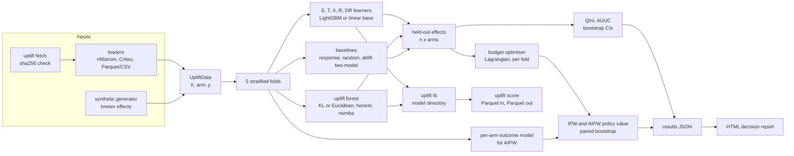

# Who should get the e-mail?

**causal-uplift-targeting** estimates which customers buy *because* they were contacted, picks a
contact policy that fits a budget, and reports what that policy is worth with doubly robust
confidence intervals. The S-, T-, X-, R- and DR-learners, the KL/Euclidean uplift forest, the Qini
and AUUC metrics, the IPW/AIPW policy evaluation and the budget optimiser are implemented in this
repository; LightGBM and scikit-learn serve as base learners, and scikit-uplift is used only as a
parity reference and a baseline.

> Status: the code, tests and benchmark harness are complete. The tables below are filled by
> `bench/run.py --profile full`; every cell marked *pending benchmark* has not been run yet and
> carries no number on purpose.

## The question

In March 2008 Kevin Hillstrom published an e-mail test on 64,000 customers who had bought in the
previous twelve months. Each customer was randomly assigned to one of three arms: an e-mail
featuring men's merchandise, an e-mail featuring women's merchandise, or no e-mail. Site visits,
conversions and spend were recorded for the following two weeks.

The memo answers one question about the next campaign:

> If we can only contact 10, 20 or 30% of these customers, who should receive which e-mail, and how
> many extra conversions will that produce compared with choosing customers at random?

"Extra" means caused by the e-mail: conversions the customer would not have made without it. A
model that predicts who is likely to buy answers a different question, and the benchmark includes
one to show the difference.

## Policy value by budget

Incremental conversions per 1,000 contacts, estimated with cross-fitted AIPW (5 folds), with 95%
bootstrap intervals over customers. "Gain vs random" is the paired difference against contacting
the same share of customers at random with a random e-mail, per 1,000 customers in the base.

| budget | policy | incremental conversions per 1,000 contacts, AIPW [95% CI] | same, IPW | gain vs random per 1,000 customers [95% CI] |
|---|---|---|---|---|
| 10% | best uplift learner | pending benchmark | pending benchmark | pending benchmark |
| 10% | response model (propensity to buy) | pending benchmark | pending benchmark | pending benchmark |
| 10% | scikit-uplift two-model | pending benchmark | pending benchmark | pending benchmark |
| 10% | random targeting | pending benchmark | pending benchmark | reference |
| 20% | best uplift learner | pending benchmark | pending benchmark | pending benchmark |
| 20% | response model | pending benchmark | pending benchmark | pending benchmark |
| 20% | scikit-uplift two-model | pending benchmark | pending benchmark | pending benchmark |
| 20% | random targeting | pending benchmark | pending benchmark | reference |
| 30% | best uplift learner | pending benchmark | pending benchmark | pending benchmark |
| 30% | response model | pending benchmark | pending benchmark | pending benchmark |
| 30% | scikit-uplift two-model | pending benchmark | pending benchmark | pending benchmark |
| 30% | random targeting | pending benchmark | pending benchmark | reference |

The same table for site visits (a more frequent outcome, so tighter intervals) is in
`bench/results/hillstrom_visit.json`: *pending benchmark*.

Measured on: Intel Core i5-8500 (6 cores), 12 GB RAM, Windows 10, CPU only. Date: *pending
benchmark* (taken from the `date` field of `bench/results/hillstrom_conversion.json`).

## Recommendation

*Pending benchmark.* The rule that will produce it was fixed before any result was seen and is the
one the HTML report applies:

1. At each budget, take the policy with the highest AIPW estimate.
2. Recommend model-based targeting at that budget only if its paired gain over random targeting has
   a 95% interval entirely above zero.
3. Otherwise the evidence does not support paying for a model at that budget, and the memo says so.

## Reproduce

Requires [uv](https://docs.astral.sh/uv/) and Python 3.12. No download is needed for the first
two commands: they run on a synthetic experiment whose true effects are known.

```bash
uv sync
uv run uplift synth --scenario sleeping_dogs --rows 20000 --out out/synth.parquet
uv run uplift policy --data out/synth.parquet --budget 0.1 0.2 0.3 --report out/synth-report.html
```

On the Hillstrom data (about 4 MB, verified against the sha256 in `src/causal_uplift/fetch.py`):

```bash
uv run uplift fetch hillstrom
uv run uplift policy --data hillstrom --outcome conversion --budget 0.1 0.2 0.3 --n-jobs 6 \
    --json out/hillstrom-conversion.json --report out/hillstrom-conversion.html
uv run uplift fit --data hillstrom --outcome conversion --learner dr --out models/dr
uv run uplift score --model models/dr --input customers.parquet --output scored.parquet --budget 0.2
```

`score` reads Parquet or CSV with the same feature columns as training and writes one
`uplift__<arm>` column per e-mail, the best arm, and with `--budget` the assigned arm. Data go to
`$CAUSAL_UPLIFT_DATA_DIR` (default `~/.cache/causal-uplift-targeting`).

With Docker (non-root image running as uid 10001, so mounted directories must be writable by it;
no compilers in the runtime stage):

```bash
docker build -t causal-uplift-targeting .
docker run --rm -v "$PWD/data:/data" causal-uplift-targeting fetch hillstrom
docker run --rm -v "$PWD/data:/data" -v "$PWD/out:/work" causal-uplift-targeting \
    policy --data hillstrom --outcome conversion --report /work/report.html
```

The full benchmark and the tables in this file:

```bash
uv run uplift fetch hillstrom
uv run python bench/run.py --profile full   # writes bench/results/*.json
uv run python bench/tables.py               # prints these tables from those files
```

Tests: `uv run pytest` (no network, no downloads; tests on the real file skip if it is absent).

## Ranking quality on Hillstrom

Normalised Qini coefficient and AUUC (scikit-uplift's definitions) per e-mail against no e-mail,
on held-out folds, with 95% bootstrap intervals, and the median fit time per fold on about 51,000
training rows. Every learner is fitted once on a small synthetic sample before timing starts, so
numba compilation and LightGBM thread start-up are not counted.

| learner | Qini, Mens e-mail | Qini, Womens e-mail | AUUC, Mens e-mail | AUUC, Womens e-mail | median fit s / fold |
|---|---|---|---|---|---|
| S-learner | pending benchmark | pending benchmark | pending benchmark | pending benchmark | pending benchmark |
| T-learner | pending benchmark | pending benchmark | pending benchmark | pending benchmark | pending benchmark |
| X-learner | pending benchmark | pending benchmark | pending benchmark | pending benchmark | pending benchmark |
| R-learner | pending benchmark | pending benchmark | pending benchmark | pending benchmark | pending benchmark |
| DR-learner | pending benchmark | pending benchmark | pending benchmark | pending benchmark | pending benchmark |
| uplift forest, KL | pending benchmark | pending benchmark | pending benchmark | pending benchmark | pending benchmark |
| uplift forest, Euclidean | pending benchmark | pending benchmark | pending benchmark | pending benchmark | pending benchmark |
| response model | pending benchmark | pending benchmark | pending benchmark | pending benchmark | pending benchmark |
| scikit-uplift two-model | pending benchmark | pending benchmark | pending benchmark | pending benchmark | pending benchmark |
| random scores | pending benchmark | pending benchmark | pending benchmark | pending benchmark | pending benchmark |

## Error against known effects (synthetic)

PEHE (root mean squared error of the estimated effect against the true one, probability scale) on
an independent test draw of 10,000 rows after training on 20,000, mean and standard deviation over
three seeds. `sleeping_dogs` is built so that the customers most likely to buy are the ones the
e-mail puts off; `confounded` has feature-dependent assignment and uses estimated propensities.

| learner | linear | step | sleeping_dogs | confounded |
|---|---|---|---|---|
| S-learner | pending benchmark | pending benchmark | pending benchmark | pending benchmark |
| T-learner | pending benchmark | pending benchmark | pending benchmark | pending benchmark |
| X-learner | pending benchmark | pending benchmark | pending benchmark | pending benchmark |
| R-learner | pending benchmark | pending benchmark | pending benchmark | pending benchmark |
| DR-learner | pending benchmark | pending benchmark | pending benchmark | pending benchmark |
| uplift forest, KL (honest) | pending benchmark | pending benchmark | pending benchmark | pending benchmark |
| uplift forest, KL (adaptive) | pending benchmark | pending benchmark | pending benchmark | pending benchmark |
| uplift forest, Euclidean | pending benchmark | pending benchmark | pending benchmark | pending benchmark |
| scikit-uplift two-model | pending benchmark | pending benchmark | pending benchmark | pending benchmark |
| response model (not an effect estimate) | pending benchmark | pending benchmark | pending benchmark | pending benchmark |

## Limits of this analysis

* One retailer, one test, 2008, a two-week window. A policy learned here is evidence about this
  population, not a rule for another one.
* Conversions are rare, so differences of a few conversions per 1,000 customers can sit inside the
  intervals. 64,000 customers is small for ranking individuals by a causal effect.
* The bootstrap holds the fitted models fixed: intervals include evaluation noise, not the variance
  of refitting the learners. They are narrower than a repeated-split procedure would give.
* The recommended policy is the best of several evaluated on the same data, so its estimate is
  optimistic (winner's curse). Nothing corrects for that.
* Costs are equal per contact unless `--arm-cost` is given, and the objective counts outcomes, not
  margin. Spend can be used as the outcome, but only with the Euclidean forest and the meta-learners.
* The uplift forest uses 32 quantile bins per feature and omits the split-normalisation term of the
  original method (ADR 0002). With the default leaf size it cannot split on a few thousand rows.
* LightGBM defaults were chosen on the synthetic generator (seeds 3 and 4, disjoint from the
  benchmark seeds), not tuned per learner or per data set.
* The Criteo scale run (`bench/run.py --profile criteo`) is implemented but **not run**; its data
  were not downloaded.
* Saved models are pickles: load only model directories you created.

## Data and licences

| data | source | licence | status |
|---|---|---|---|
| Hillstrom MineThatData e-mail test | [minethatdata.com](http://www.minethatdata.com/Kevin_Hillstrom_MineThatData_E-MailAnalytics_DataMiningChallenge_2008.03.20.csv), sha256 `0e5893329d8b93cefecc571777672028290ab69865718020c78c7284f291aece` | no explicit licence; published by Kevin Hillstrom for the 2008 MineThatData challenge. Not redistributed here. | used |
| Criteo Uplift v2.1 | [huggingface.co/datasets/criteo/criteo-uplift](https://huggingface.co/datasets/criteo/criteo-uplift) (the original go.criteo.net link returned 404 on 2026-10-09); sha256 from the repository's LFS pointer, not verified locally | CC BY-NC-SA 4.0, non-commercial. Not redistributed here. | not run |
| synthetic experiments | generated by `causal_uplift.synthetic` | MIT, with this code | used |

No pretrained models are used; the fitted learners are the only model artifacts. Libraries:
LightGBM (MIT), scikit-learn (BSD-3-Clause), numba (BSD-2-Clause), numpy (BSD-3-Clause), polars
(MIT), matplotlib (matplotlib licence, BSD-style); scikit-uplift (MIT) in tests and benchmarks only.

Code: MIT, Copyright (c) 2026 Daniel Lopez.

## Appendix A: how the numbers are produced



**Learners** (`learners.py`). Arm 0 is control; every learner returns one effect column per e-mail.

* S-learner: one outcome model on features plus arm indicators; effect = prediction with the arm
  switched on minus with it off.
* T-learner: one outcome model per arm; effect = difference of predictions.
* X-learner (Kuenzel et al. 2019): impute individual effects with the other arm's model, fit effect
  models on each side, blend them by the propensity.
* R-learner (Nie and Wager 2021): cross-fitted residuals of outcome and treatment, then a weighted
  regression of their ratio, which minimises the R-loss.
* DR-learner (Kennedy 2023): regress the cross-fitted AIPW pseudo-outcome on features.
* Response model (baseline): predicted conversion probability if e-mailed. It ignores what the
  customer would have done anyway.

**Uplift forest** (`forest.py`, `_tree_kernels.py`): divergence splits after Rzepakowski and
Jaroszewicz (2012) with KL or squared-difference divergence averaged over e-mails, histogram split
search in numba, per-tree subsampling and honest leaves (ADR 0002).

**Ranking metrics** (`metrics.py`): Qini and uplift curves with tied scores evaluated together,
normalised by the perfect ranking, matching scikit-uplift to 1e-9 in the tests. Bootstrap
replicates reuse one sort and reweight rows.

**Policy value** (`ope.py`): a policy is an (n x arms) probability matrix. IPW scores are
`1{A=a} Y / e_a`; AIPW scores add a cross-fitted outcome model, `mu_a + 1{A=a}(Y - mu_a) / e_a`.
Propensities are the randomisation shares. Intervals are percentile bootstraps over customers, with
all policies resampled together (ADR 0001).

**Budget optimiser** (`policy.py`): Lagrangian relaxation of the multiple-choice knapsack with
greedy fill and a dual upper bound (ADR 0003).

## Appendix B: assumptions

* Randomisation: assignment does not depend on unobserved factors, and its probabilities are known
  (one third per arm in Hillstrom).
* No interference: one customer's e-mail does not change another customer's outcome.
* Overlap: every customer could have received every arm, which randomisation guarantees.
* Stability: the customers the policy is applied to resemble the 2008 test population.

## Appendix C: repository map

| path | contents |
|---|---|
| `src/causal_uplift/` | library and the `uplift` CLI |
| `bench/run.py`, `bench/tables.py` | benchmark harness and table printer |
| `bench/baselines.py` | scikit-uplift two-model wrapper (benchmark and tests only) |
| `bench/results/` | benchmark JSON with machine, date, git sha and command |
| `docs/adr/` | design decisions |
| `tests/` | pytest suite; `tests/golden/` holds the report fixture |
