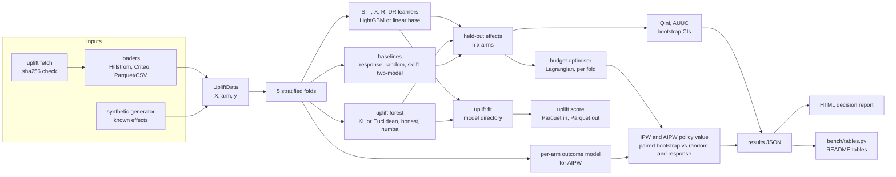

# Who should get the e-mail?

**causal-uplift-targeting** estimates which customers buy *because* they were contacted, picks a
contact policy that fits a budget, and reports what that policy is worth with doubly robust
confidence intervals. The S-, T-, X-, R- and DR-learners, the KL/Euclidean uplift forest, the Qini
and AUUC metrics, the IPW/AIPW policy evaluation and the budget optimiser are implemented in this
repository; LightGBM and scikit-learn serve as base learners, and scikit-uplift is used only as a
parity reference and a baseline.

Every number below is copied from `bench/results/*.json` (printed by `bench/tables.py`); each file
records the machine, date, git commit and command that produced it.

## The question

In March 2008 Kevin Hillstrom published an e-mail test on 64,000 customers who had bought in the
previous twelve months. Each customer was randomly assigned to one of three arms: an e-mail
featuring men's merchandise, an e-mail featuring women's merchandise, or no e-mail. Site visits,
conversions and spend were recorded for the following two weeks. Conversion rates were 0.6% with no
e-mail, 1.3% with the Mens e-mail and 0.9% with the Womens e-mail.

The memo answers one question about the next campaign:

> If we can only contact 10, 20 or 30% of these customers, who should receive which e-mail, and how
> many extra conversions will that produce compared with choosing customers at random?

"Extra" means caused by the e-mail: conversions the customer would not have made without it. A
model that predicts who is likely to buy answers a different question, and the benchmark includes
one (the response model) to show the difference.

## Policy value by budget

Incremental conversions per 1,000 contacts, estimated with cross-fitted AIPW (5 folds), with 95%
bootstrap intervals over customers (1,000 replicates). The IPW column is the same quantity without
an outcome model. The two gain columns are paired AIPW differences per 1,000 customers in the base:
against contacting the same share at random with a random e-mail, and against ranking by the
response model. "Best uplift learner" is the highest AIPW value among the seven learners
implemented here, picked after seeing these results.

| budget | policy | share e-mailed (Mens / Womens) | incremental conversions per 1,000 contacts, AIPW [95% CI] | same, IPW | gain vs random targeting per 1,000 customers [95% CI] | gain vs response model per 1,000 customers [95% CI] |
|---|---|---|---|---|---|---|
| 10% | best uplift learner: T-learner | 7% / 3% | 9.6 [2.4, 16.8] | 9.4 | 0.46 [-0.21, 1.18] | -0.01 [-0.58, 0.56] |
| 10% | response model | 7% / 3% | 9.7 [2.3, 17.9] | 9.4 | 0.48 [-0.25, 1.27] | reference |
| 10% | scikit-uplift two-model | 7% / 3% | 9.6 [2.4, 16.8] | 9.4 | 0.46 [-0.21, 1.18] | -0.01 [-0.58, 0.56] |
| 10% | random targeting | 5% / 5% | 4.9 [3.6, 6.3] | 5.0 | reference | -0.48 [-1.27, 0.25] |
| 20% | best uplift learner: T-learner | 14% / 6% | 9.3 [4.6, 14.1] | 9.6 | 0.87 [0.06, 1.76] | 0.33 [-0.46, 1.06] |
| 20% | response model | 15% / 5% | 7.6 [2.6, 12.8] | 7.7 | 0.54 [-0.37, 1.47] | reference |
| 20% | scikit-uplift two-model | 14% / 6% | 9.3 [4.6, 14.1] | 9.6 | 0.87 [0.06, 1.76] | 0.33 [-0.46, 1.06] |
| 20% | random targeting | 10% / 10% | 4.9 [3.4, 6.3] | 5.0 | reference | -0.54 [-1.47, 0.37] |
| 30% | best uplift learner: X-learner | 22% / 8% | 9.8 [6.1, 13.5] | 9.8 | 1.45 [0.52, 2.43] | 0.52 [-0.23, 1.34] |
| 30% | response model | 22% / 8% | 8.0 [4.1, 11.7] | 8.1 | 0.92 [0.00, 1.84] | reference |
| 30% | scikit-uplift two-model | 21% / 9% | 8.3 [4.6, 12.3] | 8.6 | 1.02 [0.11, 2.04] | 0.10 [-0.64, 0.81] |
| 30% | random targeting | 15% / 15% | 4.9 [3.4, 6.3] | 5.0 | reference | -0.92 [-1.84, -0.00] |

The T-learner and the scikit-uplift two-model approach give identical rows because they are the
same estimator on the same LightGBM settings and folds; the tests check that parity. All seven
learners and every budget are in [Appendix D](#appendix-d-all-policies-and-site-visits), together
with the same tables for site visits.

Measured on: Intel Core i5-8500 (6 cores), 12 GB RAM (11.9 GB visible to the OS), Windows 10
(10.0.19045), Python 3.12.14, CPU only; numpy 2.5.3, LightGBM 4.7.0, scikit-learn 1.9.1, numba
0.68.0, scikit-uplift 0.5.1. Date 2026-10-09, commit `2b93f0b`, command
`uv run python bench/run.py --profile full`. Wall time 151.6 s for the conversion suite, 188.9 s for
site visits and 56.5 s for the synthetic suite.

## Recommendation

The rule was fixed before any result was seen and is the one the HTML report applies: at each
budget take the policy with the highest AIPW estimate, and recommend model-based targeting only if
its paired gain over random targeting has a 95% interval entirely above zero.

* **10% budget: no model.** The highest estimate belongs to the response model, 0.48 extra
  conversions per 1,000 customers over random targeting with an interval of [-0.25, 1.27]. That
  includes zero, so this test does not justify paying for targeting at 10%.
* **20% budget: target with the T-learner**, sending the Mens e-mail to 14% and the Womens e-mail
  to 6% of customers. Estimated 9.3 incremental conversions per 1,000 contacts [4.6, 14.1] against
  4.9 for random targeting; the paired gain is 0.87 per 1,000 customers [0.06, 1.76].
* **30% budget: target with the X-learner**, Mens e-mail to 22% and Womens e-mail to 8%. Estimated
  9.8 incremental conversions per 1,000 contacts [6.1, 13.5]; paired gain over random targeting
  1.45 per 1,000 customers [0.52, 2.43].

What the evidence does not show: that modelling the effect beats modelling the outcome on this
data. No uplift learner's paired difference against the response model excludes zero, at any
budget, for conversions or for visits (largest for conversions: X-learner at 30%, 0.52 per 1,000
customers [-0.23, 1.34]). The winner also changes between budgets, and the 20% interval only just
clears zero. If the alternative is no targeting, target 20 to 30% of customers, mostly with the
Mens e-mail. If the alternative is a response model the team already runs, this test cannot tell
the two apart; the synthetic `sleeping_dogs` scenario below shows the kind of population where the
difference becomes large.

## Reproduce

Requires [uv](https://docs.astral.sh/uv/) and Python 3.12. No download is needed for the first
two commands: they run on a synthetic experiment whose true effects are known.

```bash
uv sync
uv run uplift synth --scenario sleeping_dogs --rows 20000 --out out/synth.parquet
uv run uplift policy --data out/synth.parquet --budget 0.1 0.2 0.3 --report out/synth-report.html
```

On the Hillstrom data (about 4 MB, verified against the sha256 in `src/causal_uplift/fetch.py`):

```bash
uv run uplift fetch hillstrom
uv run uplift policy --data hillstrom --outcome conversion --budget 0.1 0.2 0.3 --n-jobs 6 \
    --json out/hillstrom-conversion.json --report out/hillstrom-conversion.html
uv run uplift fit --data hillstrom --outcome conversion --learner dr --out models/dr
uv run uplift score --model models/dr --input customers.parquet --output scored.parquet --budget 0.2
```

`score` reads Parquet or CSV with the same feature columns as training and writes one
`uplift__<arm>` column per e-mail, the best arm, and with `--budget` the assigned arm. Data go to
`$CAUSAL_UPLIFT_DATA_DIR` (default `~/.cache/causal-uplift-targeting`).

With Docker (non-root image running as uid 10001, so mounted directories must be writable by it;
no compilers in the runtime stage):

```bash
docker build -t causal-uplift-targeting .
docker run --rm -v "$PWD/data:/data" causal-uplift-targeting fetch hillstrom
docker run --rm -v "$PWD/data:/data" -v "$PWD/out:/work" causal-uplift-targeting \
    policy --data hillstrom --outcome conversion --report /work/report.html
```

The full benchmark and the tables in this file (the run above took under seven minutes on the
machine named in the Measured-on line):

```bash
uv run uplift fetch hillstrom
uv run python bench/run.py --profile full   # writes bench/results/*.json
uv run python bench/tables.py               # prints these tables from those files
```

`bench/run.py --profile smoke --out-dir <dir>` runs a reduced version in seconds and writes
`smoke-*.json` files, which are not results and are ignored by git.

Tests: `uv run pytest` (no network, no downloads; tests on the real file skip if it is absent).

## Ranking quality on Hillstrom

Normalised Qini coefficient and AUUC (scikit-uplift's definitions) per e-mail against no e-mail,
for conversions, on held-out folds with 95% bootstrap intervals, and the median fit time per fold
on 51,200 training rows. Every learner is fitted once on a small synthetic sample before timing
starts, so numba compilation and LightGBM thread start-up are not counted.

| learner | Qini coef., Mens E-Mail [95% CI] | Qini coef., Womens E-Mail [95% CI] | AUUC, Mens E-Mail [95% CI] | AUUC, Womens E-Mail [95% CI] | median fit s / fold |
|---|---|---|---|---|---|
| S-learner | 0.026 [-0.031, 0.088] | 0.101 [0.031, 0.168] | 0.0009 [-0.0012, 0.0030] | 0.0029 [0.0009, 0.0049] | 0.30 |
| T-learner | 0.014 [-0.049, 0.077] | 0.061 [-0.009, 0.128] | 0.0005 [-0.0018, 0.0027] | 0.0017 [-0.0003, 0.0037] | 0.32 |
| X-learner | -0.006 [-0.063, 0.057] | 0.086 [0.017, 0.157] | -0.0002 [-0.0022, 0.0021] | 0.0025 [0.0005, 0.0046] | 1.05 |
| R-learner | -0.006 [-0.065, 0.055] | 0.056 [-0.019, 0.125] | -0.0002 [-0.0023, 0.0019] | 0.0016 [-0.0006, 0.0036] | 1.03 |
| DR-learner | -0.008 [-0.068, 0.053] | 0.054 [-0.022, 0.124] | -0.0003 [-0.0024, 0.0019] | 0.0015 [-0.0007, 0.0035] | 1.14 |
| uplift forest, KL (honest) | 0.012 [-0.044, 0.073] | 0.088 [0.021, 0.159] | 0.0004 [-0.0016, 0.0026] | 0.0026 [0.0006, 0.0046] | 0.29 |
| uplift forest, Euclidean (honest) | 0.024 [-0.034, 0.083] | 0.093 [0.025, 0.164] | 0.0009 [-0.0012, 0.0030] | 0.0027 [0.0007, 0.0047] | 0.28 |
| response model | 0.033 [-0.020, 0.092] | 0.068 [0.004, 0.133] | 0.0012 [-0.0008, 0.0034] | 0.0019 [0.0001, 0.0039] | 0.21 |
| random scores | -0.015 [-0.078, 0.043] | -0.006 [-0.069, 0.060] | -0.0005 [-0.0027, 0.0016] | -0.0002 [-0.0020, 0.0018] | 0.00 |
| scikit-uplift two-model | 0.014 [-0.049, 0.077] | 0.061 [-0.009, 0.128] | 0.0005 [-0.0018, 0.0027] | 0.0017 [-0.0003, 0.0037] | 0.45 |

For the Mens e-mail every interval includes zero, the random scores' included: 64,000 customers
and about 1% conversion are not enough to rank individuals by that e-mail's effect. For the Womens
e-mail the S-learner, X-learner, both forests and the response model have intervals above zero.
The policy table above does not follow the Qini order because a budgeted policy only uses the top
of each ranking and also chooses between the two e-mails.

## Error against known effects (synthetic)

PEHE (root mean squared error of the estimated effect against the true one, probability scale) on
an independent test draw of 10,000 rows after training on 20,000, mean ± standard deviation over
three seeds. `sleeping_dogs` is built so that the customers most likely to buy are the ones the
e-mail puts off; `confounded` has feature-dependent assignment and uses estimated propensities.
The response model's column is its predicted purchase probability scored as if it were an effect,
which is how it gets used when people rank by it. The last column is the mean fit time over all
scenarios and seeds.

| learner | linear | step | sleeping_dogs | confounded | mean fit s (20k rows, all scenarios) |
|---|---|---|---|---|---|
| S-learner | 0.0361 ± 0.0029 | 0.0317 ± 0.0021 | 0.0422 ± 0.0044 | 0.0291 ± 0.0029 | 0.18 |
| T-learner | 0.0518 ± 0.0012 | 0.0512 ± 0.0024 | 0.0504 ± 0.0027 | 0.0553 ± 0.0030 | 0.33 |
| X-learner | 0.0406 ± 0.0005 | 0.0416 ± 0.0027 | 0.0409 ± 0.0017 | 0.0436 ± 0.0036 | 0.69 |
| R-learner | 0.0500 ± 0.0003 | 0.0499 ± 0.0022 | 0.0510 ± 0.0008 | 0.0576 ± 0.0025 | 0.73 |
| DR-learner | 0.0505 ± 0.0003 | 0.0501 ± 0.0024 | 0.0511 ± 0.0009 | 0.0585 ± 0.0012 | 0.94 |
| uplift forest, KL (honest) | 0.0329 ± 0.0015 | 0.0295 ± 0.0009 | 0.0185 ± 0.0054 | 0.0560 ± 0.0045 | 0.15 |
| uplift forest, Euclidean (honest) | 0.0320 ± 0.0019 | 0.0279 ± 0.0005 | 0.0211 ± 0.0058 | 0.0558 ± 0.0043 | 0.15 |
| response model | 0.2680 ± 0.0030 | 0.2137 ± 0.0020 | 0.3969 ± 0.0025 | 0.2611 ± 0.0021 | 0.19 |
| scikit-uplift two-model | 0.0518 ± 0.0012 | 0.0512 ± 0.0024 | 0.0504 ± 0.0027 | 0.0553 ± 0.0030 | 0.36 |
| uplift forest, KL (adaptive) | 0.0328 ± 0.0006 | 0.0328 ± 0.0025 | 0.0269 ± 0.0030 | 0.0573 ± 0.0049 | 0.21 |
| oracle (true effects) | 0.0000 ± 0.0000 | 0.0000 ± 0.0000 | 0.0000 ± 0.0000 | 0.0000 ± 0.0000 | n/a |

Qini coefficient on the same test draws (mean over three seeds; `confounded` is left out because
Qini assumes randomised assignment):

| learner | linear, arm1 | linear, arm2 | step, arm1 | step, arm2 | sleeping_dogs, arm1 | sleeping_dogs, arm2 |
|---|---|---|---|---|---|---|
| S-learner | 0.034 | 0.047 | 0.076 | 0.042 | 0.096 | 0.051 |
| T-learner | 0.020 | 0.034 | 0.056 | 0.025 | 0.101 | 0.055 |
| X-learner | 0.024 | 0.042 | 0.065 | 0.031 | 0.100 | 0.056 |
| R-learner | 0.023 | 0.037 | 0.060 | 0.032 | 0.103 | 0.057 |
| DR-learner | 0.024 | 0.037 | 0.059 | 0.033 | 0.103 | 0.057 |
| uplift forest, KL (honest) | 0.033 | 0.045 | 0.072 | 0.044 | 0.102 | 0.058 |
| uplift forest, Euclidean (honest) | 0.034 | 0.051 | 0.075 | 0.046 | 0.103 | 0.058 |
| response model | 0.014 | 0.027 | 0.061 | 0.027 | -0.112 | -0.059 |
| scikit-uplift two-model | 0.020 | 0.034 | 0.056 | 0.025 | 0.101 | 0.055 |
| uplift forest, KL (adaptive) | 0.028 | 0.042 | 0.073 | 0.041 | 0.102 | 0.057 |
| oracle (true effects) | 0.050 | 0.058 | 0.084 | 0.043 | 0.098 | 0.050 |

What these show:

* On `sleeping_dogs` the response model ranks backwards: Qini -0.112 and -0.059, while every
  uplift learner scores between 0.096 and 0.103 on arm1 and between 0.051 and 0.058 on arm2. On
  Hillstrom it does not fail like this, which is why it holds up in the policy table.
* The honest forests have the lowest PEHE on `linear`, `step` and `sleeping_dogs`. Honesty helps
  most on `sleeping_dogs` (KL 0.0185 against 0.0269 for the same forest grown adaptively) and makes
  no difference on `linear` (0.0329 and 0.0328).
* With confounded assignment the S-learner has the lowest PEHE (0.0291). The forests do not use
  propensities and come out at 0.0560 and 0.0558, close to the T-learner's 0.0553.
* The oracle does not have the highest Qini on `sleeping_dogs` (0.098 against 0.103 for the
  R-learner, DR-learner and Euclidean forest): Qini is computed from realised outcomes on 10,000
  rows, so it carries noise that ranking by the true effect cannot remove.

## Limits of this analysis

* One retailer, one test, 2008, a two-week window. A policy learned here is evidence about this
  population, not a rule for another one.
* Conversions are rare, so differences of a few conversions per 1,000 customers sit inside the
  intervals. 64,000 customers is small for ranking individuals by a causal effect: for conversions,
  every Qini interval for the Mens e-mail includes zero.
* The bootstrap holds the fitted models fixed: intervals include evaluation noise, not the variance
  of refitting the learners. They are narrower than a repeated-split procedure would give.
* The recommended policy is the best of several evaluated on the same data, so its estimate is
  optimistic (winner's curse). Nothing corrects for that.
* Costs are equal per contact unless `--arm-cost` is given, and the objective counts outcomes, not
  margin. Spend can be used as the outcome, but only with the Euclidean forest and the meta-learners.
* The uplift forest uses 32 quantile bins per feature and omits the split-normalisation term of the
  original method (ADR 0002). With the default leaf size it cannot split on a few thousand rows.
* LightGBM defaults were chosen on the synthetic generator (seeds 3 and 4, disjoint from the
  benchmark seeds), not tuned per learner or per data set.
* Fit times come from a single run on a desktop session with other processes active. A repeat of
  the full benchmark reproduced every quality metric exactly but not the timings; the DR-learner's
  times varied most. Treat the timing columns as orders of magnitude.
* The Criteo scale run (`bench/run.py --profile criteo`) is implemented but **not run**; its data
  were not downloaded, so there is no Criteo row in any table.
* Saved models are pickles: load only model directories you created.

## Data and licences

| data | source | licence | status |
|---|---|---|---|
| Hillstrom MineThatData e-mail test | [minethatdata.com](http://www.minethatdata.com/Kevin_Hillstrom_MineThatData_E-MailAnalytics_DataMiningChallenge_2008.03.20.csv), sha256 `0e5893329d8b93cefecc571777672028290ab69865718020c78c7284f291aece` | no explicit licence; published by Kevin Hillstrom for the 2008 MineThatData challenge. Not redistributed here. | used |
| Criteo Uplift v2.1 | [huggingface.co/datasets/criteo/criteo-uplift](https://huggingface.co/datasets/criteo/criteo-uplift) (the original go.criteo.net link returned 404 on 2026-10-09); sha256 from the repository's LFS pointer, not verified locally | `CC-BY-NC-SA-4.0`, non-commercial. Not redistributed here. | not run |
| synthetic experiments | generated by `causal_uplift.synthetic` | MIT, with this code | used |

No pretrained models are used; the fitted learners are the only model artifacts. Libraries:
LightGBM (MIT), scikit-learn (BSD-3-Clause), numba (BSD-2-Clause), numpy (BSD-3-Clause), polars
(MIT), matplotlib (matplotlib licence, BSD-style); scikit-uplift (MIT) in tests and benchmarks only.

Code: MIT, Copyright (c) 2026 Daniel Lopez.

## Appendix A: how the numbers are produced



**Learners** (`learners.py`). Arm 0 is control; every learner returns one effect column per e-mail.

* S-learner: one outcome model on features plus arm indicators; effect = prediction with the arm
  switched on minus with it off.
* T-learner: one outcome model per arm; effect = difference of predictions.
* X-learner (Kuenzel et al. 2019): impute individual effects with the other arm's model, fit effect
  models on each side, blend them by the propensity.
* R-learner (Nie and Wager 2021): cross-fitted residuals of outcome and treatment, then a weighted
  regression of their ratio, which minimises the R-loss.
* DR-learner (Kennedy 2023): regress the cross-fitted AIPW pseudo-outcome on features.
* Response model (baseline): predicted conversion probability if e-mailed. It ignores what the
  customer would have done anyway.

**Uplift forest** (`forest.py`, `_tree_kernels.py`): divergence splits after Rzepakowski and
Jaroszewicz (2012) with KL or squared-difference divergence averaged over e-mails, histogram split
search in numba, per-tree subsampling and honest leaves (ADR 0002).

**Ranking metrics** (`metrics.py`): Qini and uplift curves with tied scores evaluated together,
normalised by the perfect ranking, matching scikit-uplift to 1e-9 in the tests. Bootstrap
replicates reuse one sort and reweight rows.

**Policy value** (`ope.py`, `evaluation.py`): a policy is an (n x arms) probability matrix. IPW
scores are `1{A=a} Y / e_a`; AIPW scores add a cross-fitted outcome model,
`mu_a + 1{A=a}(Y - mu_a) / e_a`. Propensities are the randomisation shares. Intervals are
percentile bootstraps over customers, with all policies resampled together, so the differences
against random targeting and against the response model are paired (ADR 0001).

**Budget optimiser** (`policy.py`): Lagrangian relaxation of the multiple-choice knapsack with
greedy fill and a dual upper bound (ADR 0003).

## Appendix B: assumptions

* Randomisation: assignment does not depend on unobserved factors, and its probabilities are known
  (one third per arm in Hillstrom).
* No interference: one customer's e-mail does not change another customer's outcome.
* Overlap: every customer could have received every arm, which randomisation guarantees.
* Stability: the customers the policy is applied to resemble the 2008 test population.

## Appendix C: repository map

| path | contents |
|---|---|
| `src/causal_uplift/` | library and the `uplift` CLI |
| `bench/run.py`, `bench/tables.py` | benchmark harness and table printer |
| `bench/baselines.py` | scikit-uplift two-model wrapper (benchmark and tests only) |
| `bench/results/` | benchmark JSON with machine, date, git sha and command |
| `docs/adr/` | design decisions |
| `tests/` | pytest suite; `tests/golden/` holds the report fixture |

## Appendix D: all policies and site visits

Every evaluated policy for conversions, ordered by AIPW value within each budget
(`bench/results/hillstrom_conversion.json`):

| budget | policy | share e-mailed (Mens / Womens) | incremental conversions per 1,000 contacts, AIPW [95% CI] | same, IPW | gain vs random targeting per 1,000 customers [95% CI] | gain vs response model per 1,000 customers [95% CI] |
|---|---|---|---|---|---|---|
| 10% | response model | 7% / 3% | 9.7 [2.3, 17.9] | 9.4 | 0.48 [-0.25, 1.27] | reference |
| 10% | T-learner | 7% / 3% | 9.6 [2.4, 16.8] | 9.4 | 0.46 [-0.21, 1.18] | -0.01 [-0.58, 0.56] |
| 10% | scikit-uplift two-model | 7% / 3% | 9.6 [2.4, 16.8] | 9.4 | 0.46 [-0.21, 1.18] | -0.01 [-0.58, 0.56] |
| 10% | R-learner | 7% / 3% | 8.1 [0.5, 15.3] | 8.0 | 0.32 [-0.40, 0.99] | -0.16 [-0.83, 0.57] |
| 10% | DR-learner | 7% / 3% | 7.2 [-0.7, 14.4] | 7.0 | 0.22 [-0.52, 0.91] | -0.26 [-0.93, 0.50] |
| 10% | X-learner | 7% / 3% | 6.0 [-1.1, 12.8] | 6.1 | 0.11 [-0.57, 0.76] | -0.37 [-1.01, 0.30] |
| 10% | uplift forest, Euclidean (honest) | 9% / 1% | 5.9 [-0.9, 12.3] | 5.6 | 0.10 [-0.55, 0.71] | -0.38 [-1.19, 0.35] |
| 10% | random targeting | 5% / 5% | 4.9 [3.6, 6.3] | 5.0 | reference | -0.48 [-1.27, 0.25] |
| 10% | S-learner | 10% / 0% | 4.3 [-3.1, 11.8] | 4.2 | -0.06 [-0.76, 0.64] | -0.54 [-1.13, 0.03] |
| 10% | uplift forest, KL (honest) | 9% / 1% | 4.2 [-2.1, 10.6] | 4.2 | -0.07 [-0.68, 0.53] | -0.55 [-1.28, 0.21] |
| 20% | T-learner | 14% / 6% | 9.3 [4.6, 14.1] | 9.6 | 0.87 [0.06, 1.76] | 0.33 [-0.46, 1.06] |
| 20% | scikit-uplift two-model | 14% / 6% | 9.3 [4.6, 14.1] | 9.6 | 0.87 [0.06, 1.76] | 0.33 [-0.46, 1.06] |
| 20% | DR-learner | 15% / 5% | 8.8 [4.1, 13.4] | 9.1 | 0.77 [-0.10, 1.69] | 0.23 [-0.60, 1.09] |
| 20% | R-learner | 15% / 5% | 8.1 [3.4, 13.0] | 8.2 | 0.64 [-0.22, 1.57] | 0.10 [-0.73, 0.95] |
| 20% | response model | 15% / 5% | 7.6 [2.6, 12.8] | 7.7 | 0.54 [-0.37, 1.47] | reference |
| 20% | X-learner | 15% / 5% | 7.6 [3.1, 12.2] | 7.7 | 0.54 [-0.28, 1.37] | -0.00 [-0.84, 0.79] |
| 20% | S-learner | 19% / 1% | 6.8 [1.5, 12.0] | 7.0 | 0.38 [-0.55, 1.30] | -0.16 [-0.90, 0.56] |
| 20% | uplift forest, Euclidean (honest) | 19% / 1% | 6.1 [1.4, 10.7] | 6.1 | 0.24 [-0.58, 1.08] | -0.30 [-1.27, 0.65] |
| 20% | random targeting | 10% / 10% | 4.9 [3.4, 6.3] | 5.0 | reference | -0.54 [-1.47, 0.37] |
| 20% | uplift forest, KL (honest) | 19% / 1% | 3.9 [-0.7, 8.4] | 3.8 | -0.21 [-1.00, 0.63] | -0.75 [-1.60, 0.22] |
| 30% | X-learner | 22% / 8% | 9.8 [6.1, 13.5] | 9.8 | 1.45 [0.52, 2.43] | 0.52 [-0.23, 1.34] |
| 30% | T-learner | 21% / 9% | 8.3 [4.6, 12.3] | 8.6 | 1.02 [0.11, 2.04] | 0.10 [-0.64, 0.81] |
| 30% | scikit-uplift two-model | 21% / 9% | 8.3 [4.6, 12.3] | 8.6 | 1.02 [0.11, 2.04] | 0.10 [-0.64, 0.81] |
| 30% | DR-learner | 22% / 8% | 8.2 [4.5, 11.6] | 8.3 | 0.98 [0.06, 1.83] | 0.05 [-0.81, 0.91] |
| 30% | response model | 22% / 8% | 8.0 [4.1, 11.7] | 8.1 | 0.92 [0.00, 1.84] | reference |
| 30% | S-learner | 29% / 1% | 7.4 [3.2, 11.4] | 7.7 | 0.75 [-0.33, 1.74] | -0.18 [-0.99, 0.72] |
| 30% | R-learner | 22% / 8% | 7.4 [3.9, 10.9] | 7.5 | 0.74 [-0.13, 1.65] | -0.18 [-1.00, 0.67] |
| 30% | uplift forest, Euclidean (honest) | 29% / 1% | 6.7 [2.8, 10.5] | 6.9 | 0.54 [-0.43, 1.53] | -0.38 [-1.29, 0.61] |
| 30% | uplift forest, KL (honest) | 28% / 2% | 5.0 [1.3, 8.7] | 5.0 | 0.03 [-0.90, 0.92] | -0.90 [-1.80, 0.06] |
| 30% | random targeting | 15% / 15% | 4.9 [3.4, 6.3] | 5.0 | reference | -0.92 [-1.84, -0.00] |

Site visits (`bench/results/hillstrom_visit.json`): visit rates were 10.6% with no e-mail, 18.3%
with the Mens e-mail and 15.1% with the Womens e-mail. Applying the same rule, every budget clears
random targeting: the Euclidean forest at 10% (gain 7.61 per 1,000 customers [5.15, 10.22]), the
response model at 20% (7.33 [4.10, 10.44]) and the R-learner at 30% (8.00 [4.88, 11.51]). Again no
uplift learner separates from the response model.

| budget | policy | share e-mailed (Mens / Womens) | incremental visits per 1,000 contacts, AIPW [95% CI] | same, IPW | gain vs random targeting per 1,000 customers [95% CI] | gain vs response model per 1,000 customers [95% CI] |
|---|---|---|---|---|---|---|
| 10% | best uplift learner: uplift forest, Euclidean (honest) | 10% / 0% | 136.9 [110.6, 164.1] | 139.0 | 7.61 [5.15, 10.22] | 1.61 [-0.08, 3.43] |
| 10% | response model | 9% / 1% | 120.8 [94.2, 147.5] | 122.9 | 6.00 [3.55, 8.57] | reference |
| 10% | scikit-uplift two-model | 9% / 1% | 118.3 [92.5, 143.2] | 118.7 | 5.75 [3.49, 8.22] | -0.25 [-2.32, 1.86] |
| 10% | random targeting | 5% / 5% | 60.7 [55.1, 65.3] | 60.9 | reference | -6.00 [-8.57, -3.55] |
| 20% | best uplift learner: T-learner | 15% / 5% | 96.9 [80.2, 113.6] | 99.3 | 7.24 [4.28, 10.27] | -0.08 [-3.18, 2.99] |
| 20% | response model | 17% / 3% | 97.3 [80.0, 114.9] | 102.9 | 7.33 [4.10, 10.44] | reference |
| 20% | scikit-uplift two-model | 15% / 5% | 96.9 [80.2, 113.6] | 99.3 | 7.24 [4.28, 10.27] | -0.08 [-3.18, 2.99] |
| 20% | random targeting | 10% / 10% | 60.7 [55.4, 65.9] | 60.9 | reference | -7.33 [-10.44, -4.10] |
| 30% | best uplift learner: R-learner | 20% / 10% | 87.4 [75.0, 99.8] | 85.1 | 8.00 [4.88, 11.51] | 0.02 [-3.64, 3.56] |
| 30% | response model | 24% / 6% | 87.3 [73.2, 101.2] | 90.9 | 7.99 [4.50, 11.64] | reference |
| 30% | scikit-uplift two-model | 21% / 9% | 79.9 [67.8, 92.6] | 80.8 | 5.77 [2.64, 9.14] | -2.22 [-5.68, 1.10] |
| 30% | random targeting | 15% / 15% | 60.7 [55.9, 66.3] | 60.9 | reference | -7.99 [-11.64, -4.50] |

| learner | Qini coef., Mens E-Mail [95% CI] | Qini coef., Womens E-Mail [95% CI] | AUUC, Mens E-Mail [95% CI] | AUUC, Womens E-Mail [95% CI] | median fit s / fold |
|---|---|---|---|---|---|
| S-learner | 0.022 [0.010, 0.036] | 0.058 [0.044, 0.076] | 0.0109 [0.0047, 0.0185] | 0.0270 [0.0200, 0.0353] | 0.30 |
| T-learner | 0.006 [-0.008, 0.020] | 0.053 [0.037, 0.070] | 0.0033 [-0.0041, 0.0106] | 0.0246 [0.0171, 0.0324] | 0.31 |
| X-learner | 0.003 [-0.011, 0.017] | 0.052 [0.037, 0.069] | 0.0012 [-0.0056, 0.0086] | 0.0241 [0.0168, 0.0313] | 0.88 |
| R-learner | 0.006 [-0.007, 0.021] | 0.052 [0.036, 0.067] | 0.0029 [-0.0037, 0.0104] | 0.0241 [0.0170, 0.0310] | 1.22 |
| DR-learner | 0.006 [-0.007, 0.020] | 0.052 [0.037, 0.067] | 0.0027 [-0.0039, 0.0102] | 0.0242 [0.0169, 0.0313] | 2.57 |
| uplift forest, KL (honest) | 0.010 [-0.004, 0.024] | 0.052 [0.037, 0.068] | 0.0052 [-0.0020, 0.0126] | 0.0238 [0.0166, 0.0311] | 0.32 |
| uplift forest, Euclidean (honest) | 0.003 [-0.011, 0.018] | 0.053 [0.037, 0.069] | 0.0017 [-0.0056, 0.0092] | 0.0242 [0.0172, 0.0316] | 0.29 |
| response model | 0.025 [0.012, 0.039] | 0.034 [0.019, 0.050] | 0.0126 [0.0060, 0.0200] | 0.0159 [0.0089, 0.0233] | 0.22 |
| random scores | 0.007 [-0.007, 0.021] | 0.005 [-0.010, 0.020] | 0.0035 [-0.0035, 0.0110] | 0.0021 [-0.0048, 0.0091] | 0.00 |
| scikit-uplift two-model | 0.006 [-0.008, 0.020] | 0.053 [0.037, 0.070] | 0.0033 [-0.0041, 0.0106] | 0.0246 [0.0171, 0.0324] | 0.43 |
